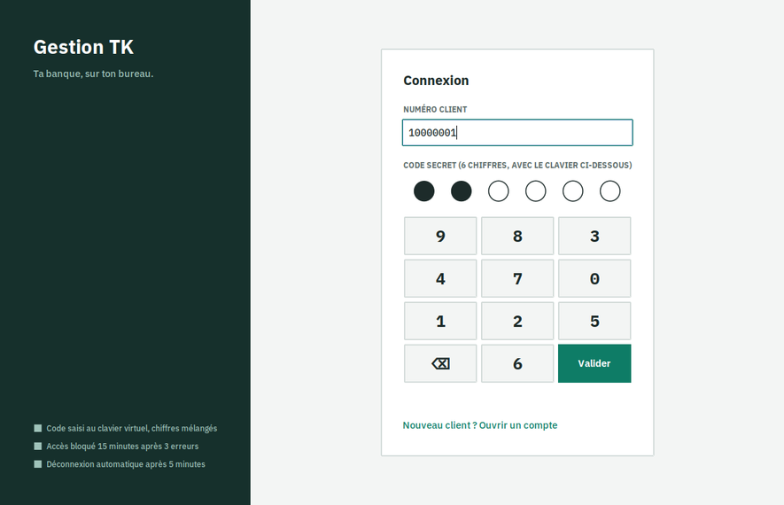
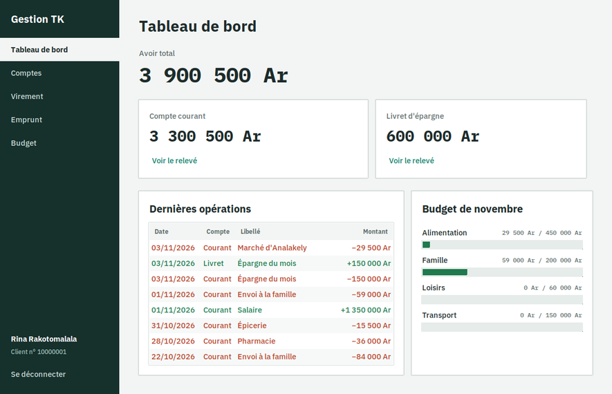
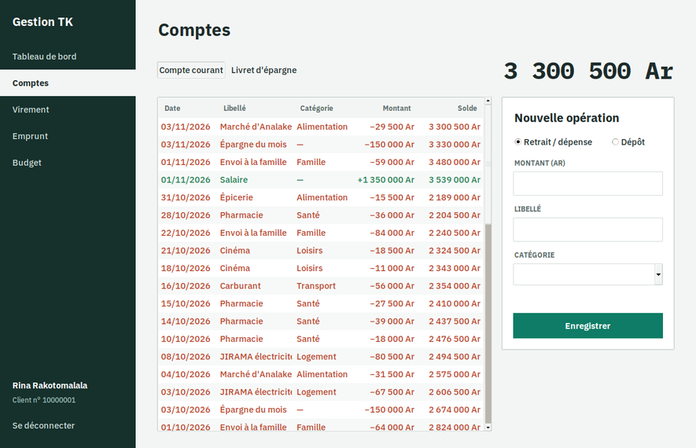
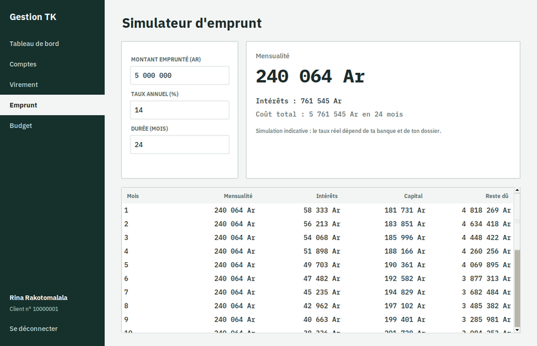

# Gestion TK

Une application bancaire de bureau, en Python et Tkinter : connexion par clavier virtuel, comptes
courant et livret, relevés, virements, simulateur d'emprunt et budget mensuel. Montants en Ariary.



> Écrite en trois jours en février 2021 : à l'époque, des maquettes d'écrans sans logique (la
> connexion ne vérifiait rien, chaque écran relançait Python). Refaite en 2026 : tout est branché,
> stocké dans SQLite et testé.

## Ce que fait l'application

- **Connexion** avec un numéro client et un code à 6 chiffres saisi au **clavier virtuel**, dont les
  chiffres changent de place à chaque ouverture. Code haché (PBKDF2), accès bloqué 15 minutes après
  3 erreurs, déconnexion automatique après 5 minutes d'inactivité.
- **Tableau de bord** : avoir total, soldes, dernières opérations, budget du mois.
- **Comptes** : relevé avec solde après chaque opération, dépôts et dépenses par catégorie.
- **Virements** entre ses comptes ou vers un autre client, avec confirmation ; les deux écritures
  sont enregistrées ensemble ou pas du tout.
- **Simulateur d'emprunt** : mensualité, coût total et tableau d'amortissement.
- **Budget** : un plafond par catégorie et la part déjà dépensée ce mois-ci.





## Lancer l'application

Prérequis : [uv](https://docs.astral.sh/uv/) et Tkinter pour le Python du système
(`sudo apt install python3-tk` sur Debian ou Ubuntu).

```bash
uv sync
uv run gestion-tk --demo   # crée une cliente de démonstration avec trois mois d'opérations
uv run gestion-tk          # numéro 10000001, code 482913 pour la démonstration
```

Les données sont dans `~/.local/share/gestion-tk/banque.sqlite3` (ou le fichier passé avec
`--db`).

## Structure

```
gestion_tk/
  bank.py       clients, comptes, opérations, virements et budget (SQLite)
  loan.py       tableau d'amortissement à mensualités constantes
  security.py   hachage des codes et clavier mélangé
  money.py      montants en Ariary : affichage et saisie
  demo.py       données de démonstration
  ui/           écrans Tkinter (ttk), une seule fenêtre
```

La logique ne dépend pas de Tkinter : elle est couverte par les tests.

```bash
uv run pytest
uv run ruff check .
```
